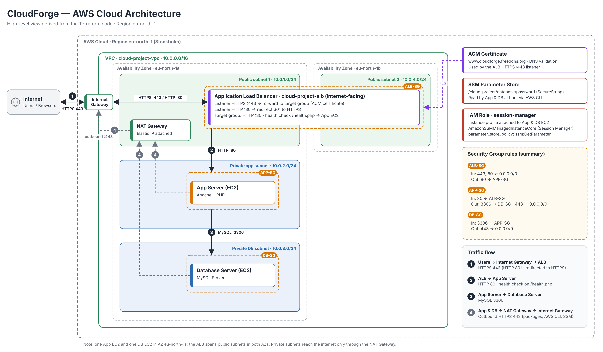
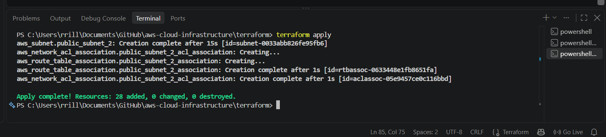
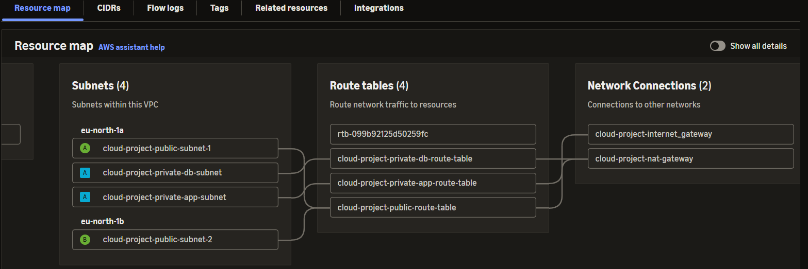
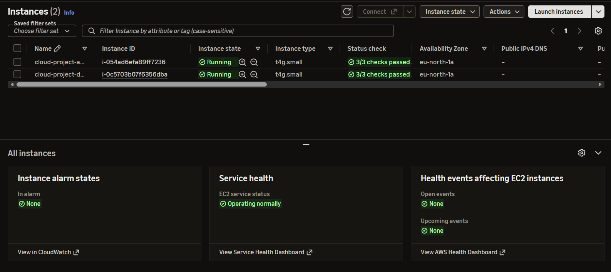
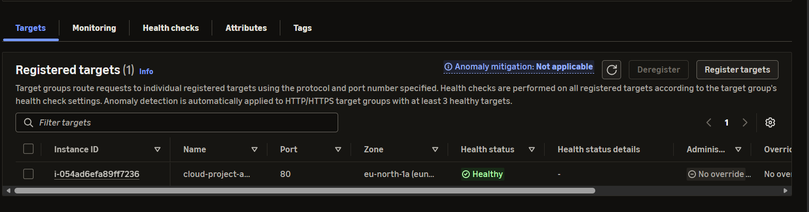
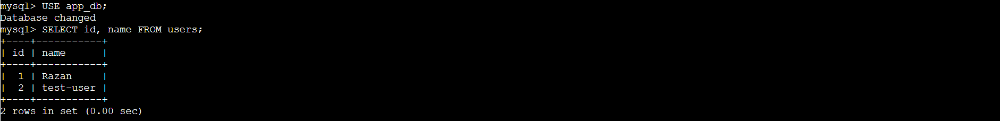

# CloudForge — AWS Cloud Infrastructure

A Terraform-based AWS cloud infrastructure project that provisions a secure, multi-tier web application environment using Amazon Web Services.

The project focuses on infrastructure automation, network segmentation, controlled access, secure application-to-database communication, and load balancing.

## Architecture



**AWS Region:** Europe (Stockholm) — `eu-north-1`

The infrastructure is organized within a custom Amazon VPC using public and private subnets across two Availability Zones.

### Architecture Overview

The architecture consists of:

- **VPC:** Custom virtual network with CIDR `10.0.0.0/16`.
- **Public Subnets:** Two public subnets across two Availability Zones.
- **Private Subnets:** Separate subnets for the application and database tiers.
- **Application Load Balancer:** Internet-facing ALB distributing incoming application traffic.
- **Application Server:** Amazon EC2 instance running Apache and PHP.
- **Database Server:** Separate Amazon EC2 instance running MySQL.
- **Internet Gateway:** Provides internet connectivity to public resources.
- **NAT Gateway:** Provides outbound internet access to private instances.
- **AWS Certificate Manager:** Manages the TLS certificate used by the HTTPS listener.
- **AWS Systems Manager Parameter Store:** Stores sensitive database configuration as a SecureString parameter.

### Network Configuration

| Component | CIDR |
|---|---|
| VPC | `10.0.0.0/16` |
| Public Subnet 1 | `10.0.1.0/24` |
| Public Subnet 2 | `10.0.4.0/24` |
| Private App Subnet | `10.0.2.0/24` |
| Private DB Subnet | `10.0.3.0/24` |

The Application Load Balancer spans both public subnets, while the application and database servers are deployed in private subnets within the first Availability Zone.

**Availability consideration:** The ALB spans two Availability Zones, but the application and database tiers each use a single EC2 instance. Therefore, the application and database layers do not provide full multi-AZ high availability.

## Traffic Flow

The application uses the following communication flow:

1. Users access the application through the internet-facing Application Load Balancer.
2. HTTP requests on port `80` are redirected to HTTPS using a `301` redirect.
3. HTTPS traffic on port `443` is handled by the ALB using an ACM certificate.
4. The ALB forwards application requests to the target group over HTTP on port `80`.
5. The application server communicates with the database server over MySQL port `3306`.
6. Private instances use the NAT Gateway for required outbound internet connectivity.

**Health Checks:** The ALB target group uses `/health.php` as its health-check endpoint.

## Infrastructure Components

| AWS Service | Purpose |
|---|---|
| Amazon VPC | Network isolation |
| Public & Private Subnets | Network segmentation |
| Internet Gateway | Public internet connectivity |
| NAT Gateway | Private outbound connectivity |
| Application Load Balancer | Traffic distribution and HTTPS termination |
| Amazon EC2 | Application and database compute instances |
| Amazon EBS | Persistent instance storage |
| Security Groups | Stateful instance-level traffic filtering |
| Network ACLs | Stateless subnet-level traffic filtering |
| AWS IAM | Instance roles and permissions |
| AWS Certificate Manager | TLS certificate management |
| AWS Systems Manager Parameter Store | Secure configuration storage |

## Security Implementation

Security was considered throughout the infrastructure design.

- **Network Segmentation:** Public-facing resources are separated from private application and database resources.
- **Restricted Database Access:** MySQL port `3306` is allowed only from the application server's Security Group.
- **Controlled Application Access:** The application server accepts HTTP traffic from the ALB Security Group rather than directly from the internet.
- **HTTPS Enforcement:** HTTP requests are redirected to HTTPS.
- **TLS Termination:** HTTPS connections are terminated at the Application Load Balancer.
- **IAM Instance Profiles:** EC2 instances use IAM roles for AWS service access.
- **Systems Manager:** Session Manager permissions support instance management without relying on publicly exposed SSH access.
- **Secure Parameter Storage:** Database credentials are stored in AWS Systems Manager Parameter Store as a SecureString.
- **Encrypted Storage:** EBS volumes use encryption.
- **Network ACLs:** Subnet-level network traffic is controlled using stateless access rules.

## Application

CloudForge includes a web-based user registration application.

**Application Stack:**
- Apache HTTP Server
- PHP
- MySQL

The application server and database server are deployed separately to demonstrate a multi-tier architecture.

The application communicates with the database over the private network rather than exposing the database directly to the internet.

## Infrastructure as Code

The infrastructure is defined and managed using **Terraform**.

Terraform is used to describe AWS resources declaratively, manage infrastructure configuration, and review planned infrastructure changes before deployment.

### Terraform Workflow

```bash
terraform init
terraform fmt -recursive
terraform validate
terraform plan
```

To provision the infrastructure in an AWS account:

```bash
terraform apply
```

To remove provisioned resources when they are no longer needed:

```bash
terraform destroy
```

AWS credentials and sensitive configuration values must be supplied securely and must not be committed to the repository.

## Testing and Validation

The project was tested through the following checks:

- Network configuration and subnet deployment.
- EC2 instance deployment and connectivity.
- Application Load Balancer health checks.
- HTTPS access and HTTP-to-HTTPS redirection.
- Application-to-database connectivity.
- MySQL database inspection.
- User registration through the web application.
- Verification of successful registration through the application interface.

## Project Screenshots

### Terraform Apply


### Network Architecture


### EC2 Instances


### Load Balancer Health Check


### Application


### Database


## Skills Demonstrated

- AWS Cloud Infrastructure
- Terraform and Infrastructure as Code (IaC)
- VPC and Subnet Design
- Public and Private Network Segmentation
- Application Load Balancing
- EC2 Instance Configuration
- Linux Server Administration
- Apache and PHP
- MySQL Database Administration
- Security Groups and Network ACLs
- IAM Roles and Instance Profiles
- AWS Systems Manager
- HTTPS and TLS
- Infrastructure Planning and Validation

## What I Learned

Through this project, I gained practical experience in designing and automating AWS infrastructure using Terraform.

I developed a better understanding of how network components, compute resources, load balancing, and database services work together in a multi-tier cloud environment.

I also learned how to implement network isolation, manage instance permissions, store sensitive configuration securely, and validate infrastructure changes before deployment.

## Project Status

**Completed — Infrastructure Provisioning, Configuration, and Testing**

The AWS infrastructure was provisioned and tested during development. The deployed resources were subsequently removed to avoid ongoing cloud costs.

The Terraform configuration, application code, architecture documentation, and project screenshots are maintained in this repository.

---

**Project:** CloudForge
**Platform:** Amazon Web Services (AWS)
**Infrastructure as Code:** Terraform
**Region:** `eu-north-1`
